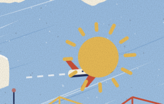

# 01. Plane flies behind the sun and does a 360 when clicked

Owner: "why is the airplane going behind the sun? also when I touch it, it does 360, what the hell"

## What happens

1. The plane crosses the sky and passes *behind* the sun disc.
2. Clicking the plane makes it roll a full turn in place.

## Cause

1. Draw order. The plane is in the sky layer (`src/scene.js:167-173`, `layer(4)`). The sun is
   drawn much later, in `sky2` (`src/scene.js:423-425`), above the night veil so that it stays
   bright at night. Anything in the sky layer therefore passes under it.
2. The click is deliberate: `plane(el) { react(el, 'loop', 1100); }` in `src/play.js:120`, with
   `@keyframes loop { to { transform: rotate(-360deg); } }` in `src/scene.css:24`. It rotates
   about the plane's own centre, so it reads as a glitch, not a loop-the-loop.

## Fix

- Keep the plane and sun from overlapping. Either move the flight path (`@keyframes fly`,
  `src/scene.css:69`) so it clears the sun at (`sx`, `sy`), or draw the plane after the sun.
  If the plane moves above the veil it will not darken at night; check night mode either way.
- Replace the 360 with something subtle (a small wing-waggle of a few degrees, or a brief
  speed-up), or drop the plane's click reaction.

## Done when

- At no point in the 46 s flight does the plane overlap the sun, day or night.
- Clicking the plane does nothing that looks like a bug.
