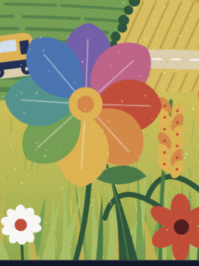

# 02. Rainbow flower is too big and out of place

Owner: "this flower is too big and out of place"

## What happens

The eight-petal rainbow flower dominates the foreground: its radius is 76 units in a
600-wide canvas, larger than the truck and the farm behind it. It is flat and saturated
against a textured gouache meadow, and it overlaps the road and the rickshaw.

## Where

`src/scene.js:400-409`: `const fx = 150, fy = 936, fr = 76;` then the petals and the
`hero-flower` group. Its click handler is `hero` in `src/play.js:126`.

## Context

The flower was the old site's signature (a 3D rainbow flower). The owner later said "the
flower is not the limitation", so it can shrink, change, or go.

## Options

- Shrink to about the size of the other wild flowers (radius 20-30) and treat it as one
  flower among them, with the same petal style and texture flecks.
- Or remove it and keep the rainbow in the containers only.

## Done when

- No single foreground flower is larger than the vehicles and buildings behind it.
- It does not cover the road, truck or rickshaw.
- If kept, clicking it still gives the pop sound and petal burst.
