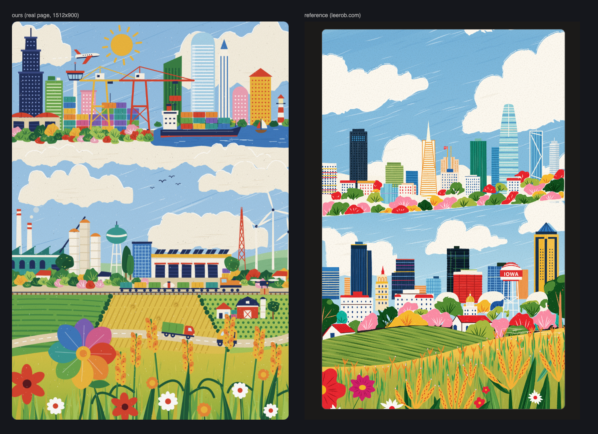

# 04. Painting still below the reference's quality

Owner, on the reference: "there is some soul to it and what you did did not have the soul".

Ours is on the left, the reference (leerob.com) on the right.

## What falls short

- Clouds: the reference's are larger and more sculpted. The cloud the port sits on reads as a slab.
- Skyline: the reference's is taller and more varied.
- Foreground: our flowers and stalks are heavier and more regular.
- Overall it still reads as generated shapes, not a drawing.

## Why

The reference is not code. It is a hand illustration: 695 vector paths (about 356 KB of SVG)
exported from a design tool, with two tiled noise overlays for paper texture and about ten
lines of CSS for drifting clouds and a hover "wind". Ours is drawn by code in `src/scene.js`.

## Decision needed from the owner

The owner asked twice to copy the reference painting and modify it. That was declined: it is
Lee Robinson's personal artwork ("representing my life and journey"), his repo has no licence,
and it would sit on Saloni's public portfolio. Do not copy its path data.

Ways to reach that quality with our own art:

1. Ask Lee Robinson who illustrated it, or for permission to adapt it.
2. Generate an original illustration with an image tool, trace it to layered SVG, animate it.
3. Commission an illustrator for a layered SVG.
4. Keep improving the code-drawn version (slowest, least likely to close the gap).

With an illustration in hand, the existing texture, wind, parallax, night mode and sounds
can be reattached to it.

## Update 2026-11-15

The owner decided to build on the reference painting. `src/painting.svg` is the reference
artwork, unmodified. `src/scene.js` loads it inline and changes it at run time:

- Removed: the Transamerica pyramid, the Salesforce tower and six more blocks from the upper
  town; the "IOWA" water tower, the pyramid-capped tower, the spired tower and the domed hall
  from the lower town; sixteen bushes in front of the new harbour.
- Added, from the earlier scene's supply-chain theme: one crane with a small container stack,
  a bay with a container ship, silos, a yellow water tower, factory chimneys, a freight train
  over the hill, a cargo plane, a pinwheel, the sun and the night layer (stars, lit windows,
  planned routes). Containers keep to four colours. The owner found a fuller port (two cranes,
  a large yard) overwhelming, so keep additions sparse and leave the reference's spacing alone.
- Kept from the reference: sky, clouds, the remaining buildings, bushes, hill, wheat,
  flowers, paper texture and the hover wind.

Still open before deploy (see 07): most of the picture is still Lee Robinson's unlicensed
artwork. Get his permission or replace the base before the site goes public.
